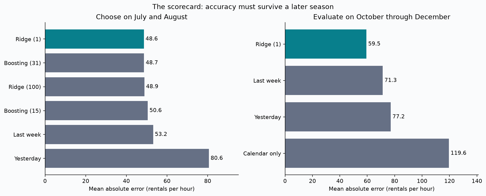
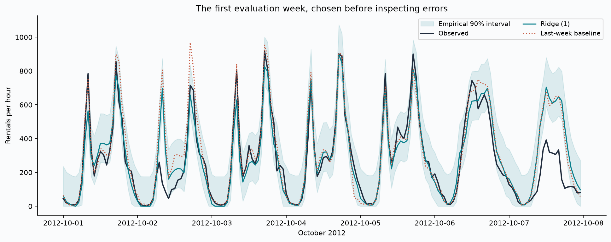
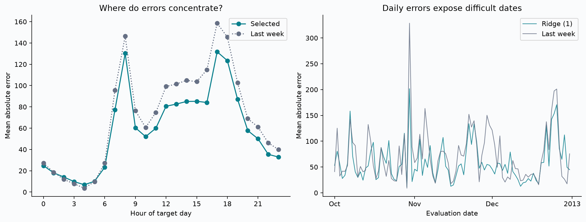
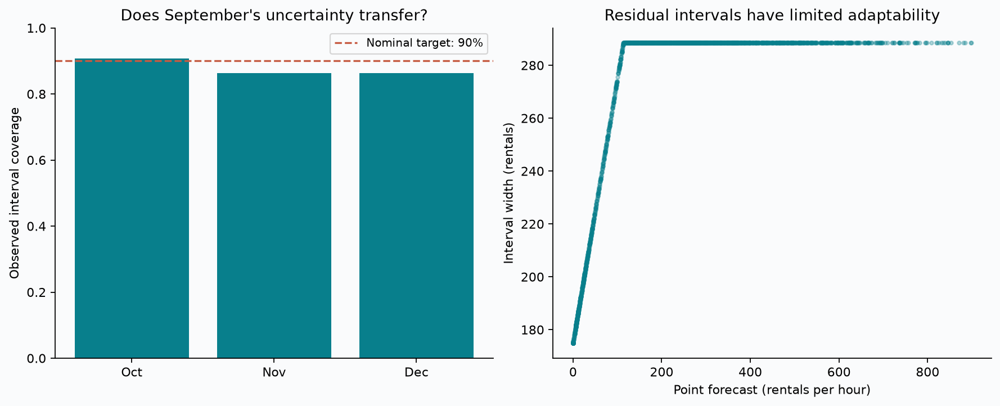
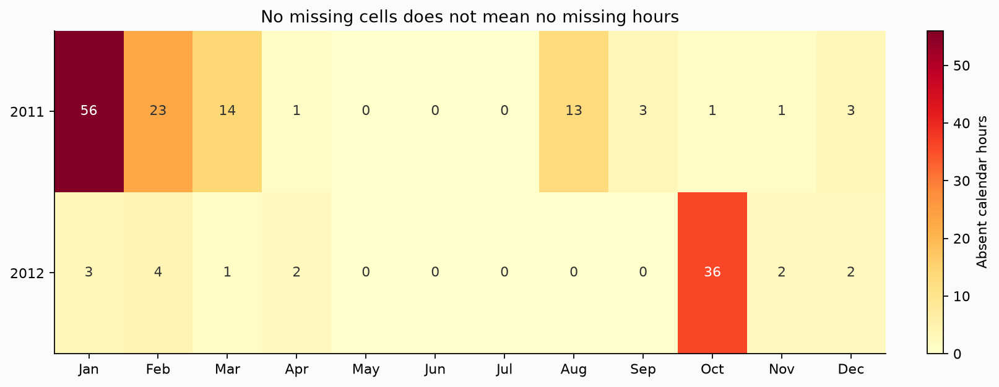
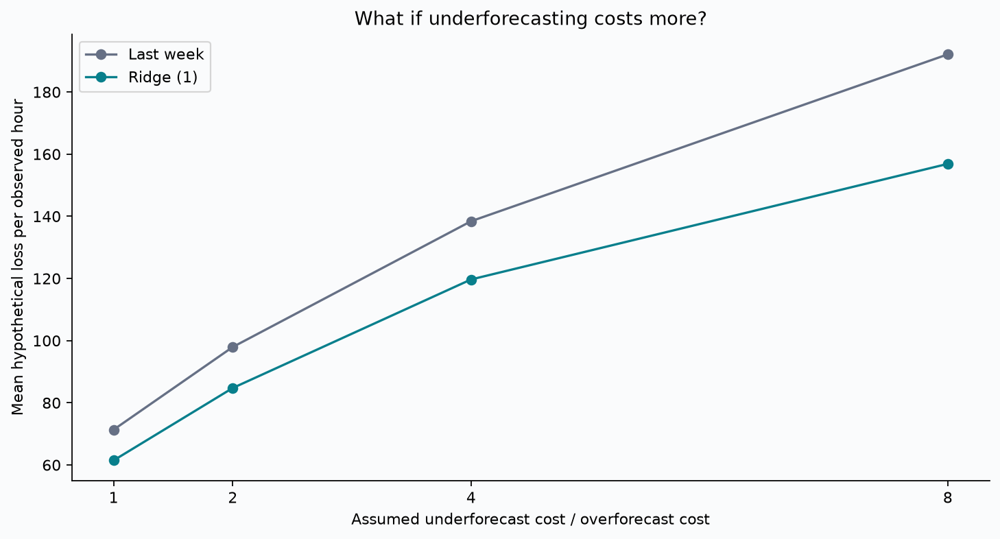

# 🚲 Rush Hour

### Tomorrow's commute. Tonight's information.

At midnight, the morning rush is still eight hours away. Can yesterday's rentals and a calendar tell us how busy the whole day will be?

Rush Hour forecasts 24 hours of aggregate Capital Bikeshare rentals at once. The interesting part is the clock: every input must already exist at midnight. No peeking at tomorrow's weather or the counts that add up to the answer.

[🚦 Results](#what-survived-the-test) · [🔧 Run it](#take-it-for-a-spin) · [🧭 Methods](docs/methods.md) · [📂 Data](DATA_LICENSE.md)



## What survived the test

A small Ridge model won the July and August comparison. On the untouched October through December window, its mean absolute error was **59.46 rentals per hour**, compared with **71.34** for the same hour last week. That is a **16.7% reduction** on the 2,168 observed test hours.

| Forecast | MAE, rentals/hour | RMSE, rentals/hour | WAPE |
| :--- | ---: | ---: | ---: |
| Ridge, alpha 1 | 59.46 | 95.45 | 27.12% |
| Same hour last week | 71.34 | 118.89 | 32.55% |
| Same hour yesterday | 77.16 | 129.31 | 35.20% |
| Ridge with calendar inputs only | 119.60 | 158.88 | 54.56% |

Historical counts did much of the work. Removing them roughly doubled Ridge's error. More complicated boosting models were close during selection, but complexity alone did not win this comparison.

The paired daily bootstrap puts the model minus baseline MAE difference at **−11.88 rentals per hour**, with a descriptive 95% interval of **−18.44 to −5.24** across 2,000 resamples. It preserves dependence within each day, not between adjacent days. This is evidence about this evaluation period, not a guarantee about another city or season.

## A week on the road



The displayed week is October 1 through 7, selected before inspecting errors. The commute peaks are visible, as are days where yesterday's information cannot explain tomorrow's changes.



Peak hours remain difficult. The saved report also includes weekday versus weekend and monthly slices. Average accuracy does not mean every date improved.

## The uncertainty has a warning light



September residuals supply fixed 5th and 95th percentile offsets. Their nominal 90% intervals covered **87.78%** of observed test outcomes. Mean width was **264.93 rentals**. Width changes only when the lower bound is clipped at zero, so the intervals cannot properly adapt to every hour's risk. No independent and identically distributed coverage guarantee is claimed.

## Missing hours are not empty stations



The archive contains 17,379 observations over 17,544 calendar hours. There are **165 absent hours**, including **40** in the final evaluation window. They remain unobserved, rather than being silently converted into zero rentals. All 2,208 planned test forecasts are retained in the CSV; every model is scored on the same observed subset.

## What would a missed forecast cost?



This sensitivity analysis makes underforecasting 1, 2, 4 or 8 times as costly as overforecasting. Each method's adjustment is learned from September residuals only. These are hypothetical relative loss units, **not dollars or demonstrated savings**. Rental totals do not reveal stockouts, latent demand, station inventory or staffing constraints.

## Take it for a spin

Use Python 3.10 or later in a virtual environment:

```sh
python -m venv .venv
# Activate .venv using your shell's activation command.
python -m pip install -e .
python -m unittest discover -s tests -v
python -m rush_hour run
```

The full run downloads the small public UCI archive, verifies its SHA256, selects models, calibrates intervals, evaluates the frozen final model and creates all six figures as PNG and SVG. It needs no account or paid service. Raw source data stays outside version control.

To inspect the source or redraw saved results without refitting:

```sh
python -m rush_hour audit
python -m rush_hour plot --report reports
```

The installed `rush-hour` command exposes the same interface. Use `--output reports/local` on `run` to keep a new run separate from the published evidence. Dependency ranges support installation; exact numerical results may differ slightly across library versions. Recorded run versions are in `reports/results.json`.

## Follow the clock

| Stage | Information used | Purpose |
| :--- | :--- | :--- |
| July and August 2012 | Expanding histories before each month | Select one of six fixed configurations |
| September 2012 | Frozen model, observed residuals | Calibrate intervals and hypothetical cost adjustments |
| October through December 2012 | Frozen model, history available at each midnight | Final evaluation |

Training examples begin January 15, 2011, allowing two weeks of history. Imputation and scaling use training rows only. Lags match clock timestamps, not neighboring CSV rows. Earlier test days may become available history, but never refit the final model.

The [study plan](docs/study-plan.md) records the design; the [methods walkthrough](docs/methods.md) explains fallbacks, calibration and statistical assumptions.

## Open the hood

| Location | What to inspect |
| :--- | :--- |
| `rush_hour/data.py` | Archive verification and strict source checks |
| `rush_hour/features.py` | Midnight information boundary and clock based lags |
| `rush_hour/models.py` | Baselines and fitted transformations |
| `rush_hour/study.py` | Chronological selection, calibration and evaluation |
| `rush_hour/evaluation.py` | Metrics, intervals and paired bootstrap |
| `rush_hour/plots.py` | Every figure above, generated from saved results |
| `tests/` | 19 tests covering leakage, gaps, calibration and calculations |
| `reports/` | Selection record, final metrics and every planned forecast |

Local validation passed all 19 tests and the complete 2,000 resample study. The workflow is configured to repeat tests and a smaller 200 resample study on Python 3.11 and 3.12. A workflow definition is not itself evidence of a successful hosted run.

## Where this stops

These are historical aggregate rentals from 2011 and 2012, not current operational demand. The clock labels lack explicit offsets, so daylight saving transitions are not reconstructed. The design assumes the previous day's final hourly count arrives by midnight. Missing labels may bias observed hour evaluation. Future weather forecasts, reporting delays and station level decisions require additional data and a new evaluation.

The central lesson is practical: **availability time is part of a feature's definition**. A useful forecast must beat a sensible baseline with information that would actually have existed when the prediction was made.

Source: [UCI Bike Sharing](https://doi.org/10.24432/C5W894), CC BY 4.0. Full attribution and the requested research citation are in [DATA_LICENSE.md](DATA_LICENSE.md). Code is available under the [MIT license](LICENSE).
